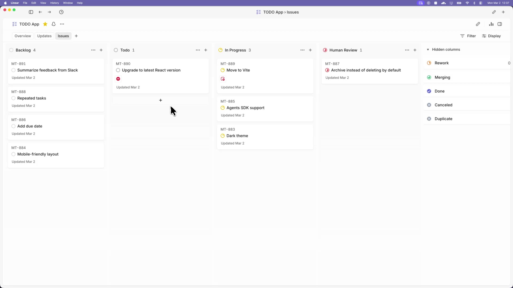

# Symphony Plus

Symphony Plus extends [OpenAI Symphony](https://github.com/openai/symphony) with durable GitHub
comment-driven workflow control and repository-local Spec Kit phases. It retains OpenAI Symphony's
isolated, autonomous implementation model so teams can manage work instead of supervising agents.

## Service, status, and automatic updates

Source-checkout installations can opt into periodic updates with the `updates` workflow block.
Updates are disabled by default. A detected default-branch revision is prepared before dispatch
drains; active work and automatic continuations are never interrupted. Activation requires a clean
attached checkout, fast-forward history, an idle managed runtime, and an external launcher or
service supervisor. Allow two check intervals plus preparation and supervisor restart time.

One Symphony Plus service can keep an installation-local registry of repository-owned workflows.
It may start with no projects; projects can then be added or removed from the dashboard or CLI
without assigning a separate service port to every repository.

The operations dashboard reports mutually exclusive running, retrying, quota-waiting, and blocked
runtime states. “Quota-waiting” means automatic renewal or recheck remains possible; “blocked”
means operator action is required. Counts and rows use the same classification.

[](https://player.vimeo.com/video/1186371009?h=5626e4b899)

_In this [demo video](https://player.vimeo.com/video/1186371009?h=5626e4b899), Symphony Plus monitors a Linear board for work and spawns agents to handle the tasks. The agents complete the tasks and provide proof of work: CI status, PR review feedback, complexity analysis, and walkthrough videos. When accepted, the agents land the PR safely. Engineers do not need to supervise Codex; they can manage the work at a higher level._

When Codex exhausts a recognized usage quota, Symphony Plus durably pauses the affected work,
releases its execution slot, and resumes the same native Codex thread after renewal. The issue
workspace and workflow checkpoints remain intact across service restarts. If the native thread can
no longer be resumed, Symphony Plus blocks for operator action instead of silently starting over.

> [!WARNING]
> Symphony Plus is a low-key engineering preview for testing in trusted environments.

## Quick start from source

Prerequisites: Bash, [Git](https://git-scm.com/), [mise](https://mise.jdx.dev/), and the
[Codex CLI](https://github.com/openai/codex). From the directory where you want the checkout:

```bash
git clone https://github.com/rohanyupadhyay/symphony-plus.git
cd symphony-plus/elixir
mise trust
mise install
mise exec -- mix setup
mise exec -- mix build
export SYMPHONY_PLUS_BIN="$PWD/bin/symphony-plus"
export SYMPHONY_PLUS_DATA_ROOT="$HOME/.local/share/symphony-plus/main"
export SYMPHONY_PLUS_LOGS_ROOT="$HOME/.local/state/symphony-plus/main/log"
export SYMPHONY_PLUS_PORT=4000
mise exec -- "$SYMPHONY_PLUS_BIN" --i-understand-that-this-will-be-running-without-the-usual-guardrails \
  --port "$SYMPHONY_PLUS_PORT" --data-root "$SYMPHONY_PLUS_DATA_ROOT" \
  --logs-root "$SYMPHONY_PLUS_LOGS_ROOT"
```

The final command starts an empty installation registry and exposes the dashboard at
`http://localhost:4000`. It does not select the bundled workflow or dispatch Codex work.
Follow the [canonical project registration journey](elixir/README.md#install-and-run-from-source)
to register the actual customized workflow in your target repository. Tracker credentials and
usable Codex authentication are required before that workflow can dispatch real issues.
See the [Elixir implementation guide](elixir/README.md) for the canonical source-install and
generic-run details.

GitHub issue orchestration uses a private GitHub App and the credential-scrubbing
`elixir/scripts/run-github` launcher instead of the generic command above. Follow the
[AI-agent installation runbook](elixir/docs/agent-installation.md) for complete onboarding, or the
[self-hosting operator guide](.symphony-plus/README.md) for this repository's concrete launch command.
App credentials stay on the host, while issue work runs only in dedicated issue workspaces.

## Running Symphony Plus

### Requirements

Symphony Plus works best in codebases that have adopted
[harness engineering](https://openai.com/index/harness-engineering/). Symphony Plus is the next step --
moving from managing coding agents to managing work that needs to get done.

### Option 1. Make your own

Tell your favorite coding agent to build Symphony Plus in a programming language of your choice:

> Implement Symphony Plus according to the following spec:
> https://github.com/rohanyupadhyay/symphony-plus/blob/main/SPEC.md

### Option 2. Use our experimental reference implementation

Check out [elixir/README.md](elixir/README.md) for instructions on how to set up your environment
and run the Elixir-based Symphony Plus implementation. You can also ask your favorite coding agent to
help with the setup:

> Set up Symphony Plus for my repository based on
> https://github.com/rohanyupadhyay/symphony-plus/blob/main/elixir/README.md

For a complete agent-operated installation in a Spec Kit repository, use the
[AI-agent installation runbook](elixir/docs/agent-installation.md). See
[GitHub workflow control](elixir/docs/github-workflow-control.md) for the protocol and security
model, including restart-safe automatic review of Symphony Plus-created pull requests in the
originating issue workspace. Successfully auto-reviewed managed pull requests can enter a
[serialized merge queue](elixir/docs/github-merge-queue.md), which revalidates each queue head
against the target revision it will actually merge into while leaving non-head branches alone.
Each operator creates and owns a private App; Symphony Plus never ships or hosts a shared
private key. Target repositories should keep their workflow and operator guide together as
`.symphony-plus/WORKFLOW.md` and `.symphony-plus/README.md`; this tool-owned directory is the documented
Symphony Plus convention.

This repository also uses Symphony Plus to update itself through GitHub Issues. The
[self-hosting operator guide](.symphony-plus/README.md) documents its approval-gated Spec Kit workflow,
manual startup command, issue controls, and isolated workspace boundary.

---

## License

This project is licensed under the [Apache License 2.0](LICENSE).
